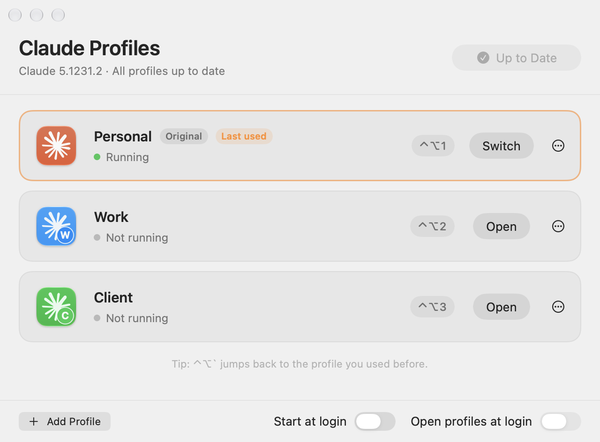

# Claude Profiles

Use more than one Claude account at the same time on a Mac, without logging out and back in.

<picture>
  <source media="(prefers-color-scheme: dark)" srcset="docs/window-dark.png">
  
</picture>

I have a personal Claude subscription and a work Team plan on the same laptop, and switching between them all day got old. This is the small tool I made for myself. It's a personal project, so feel free to use it, change it, or take it in a different direction.

## What you get

- Each account becomes its own app, like **Claude Work**, with its own login, chats and settings
- Every profile has its own color, so the Dock and Cmd-Tab always show which one is which
- Jump between profiles with ⌃⌥1, ⌃⌥2, ⌃⌥3, and go back to the previous one with ⌃⌥`
- A colored letter in the menu bar shows which profile you're in
- Profiles stay up to date when Claude updates

## Install

You need macOS 13 or later, [Claude Desktop](https://claude.ai/download) in your Applications folder, and [Homebrew](https://brew.sh). Prefer to build it yourself? See [Build it yourself](#build-it-yourself).

```sh
brew install r4w311a/tap/claude-profiles
claude-profiles install
```

The Claude Profiles window opens, and a small icon appears in your menu bar.

## Get started

1. Click **Add Profile**, type a name for the account you already use in Claude (for example "Personal"), keep **This is the account already signed in to Claude** checked, and click **Add Profile**.
2. Click **Add Profile** again for your other account, for example "Work". A new **Claude Work** app opens.
3. Sign in to your other account in that app. When macOS asks to use "Claude Safe Storage", choose **Always Allow**.

That's it. Add as many profiles as you like.

## Everyday use

| To | Do this |
| --- | --- |
| Switch to a profile | ⌃⌥1, ⌃⌥2, ⌃⌥3 and so on |
| Go back to the previous profile | ⌃⌥` |
| Move between profiles | Cmd-Tab, like any other app |
| Move between windows of one profile | Cmd-` |
| Open the Claude Profiles window | Open "Claude Profiles" from Spotlight, or click the menu bar icon and choose **Manage Profiles** |

Turn on **Start at login** and **Open profiles at login** in the window to keep your profiles ready in the background, so even the first switch of the day is instant.

## Updates

Claude updates itself as usual, and Claude Profiles updates your profiles right after. If a profile is open at the time, click **Update All** in the window or the menu bar.

To update Claude Profiles itself:

```sh
brew upgrade claude-profiles
claude-profiles install
```

## Your data and backups

Each profile keeps its data on your Mac, in `~/Library/Application Support/Claude-Profiles`. That includes things that exist only on this Mac:

- the list of your Claude Code sessions in the Code tab
- Cowork tasks
- MCP servers, extensions and settings
- the saved login

Your chats and Projects are stored in your Claude account, so they come back whenever you sign in. Claude Code transcripts are kept in `~/.claude/projects`, which all profiles share.

Back up a profile any time from its **⋯** menu (**Backups**, then **Back Up Now**), or:

```sh
claude-profiles backup Work
```

Backups are zip files in `~/Library/Application Support/Claude-Profiles Backups`. Nothing in Claude Profiles ever deletes that folder. To bring a profile back, choose **Restore from Backup…** in the same menu, or:

```sh
claude-profiles restore Work
```

`restore` uses the newest backup unless you pass a file, and moves the profile's current data to the Trash first. Run `claude-profiles backups` to see them all.

Deleting a profile's data always asks you to confirm, and backs it up first unless you choose not to.

## Good to know

- Your first account stays in the regular Claude app. The others are copies of it that live in `~/Applications/Claude Profiles` and take almost no disk space.
- The copies are signed on your Mac instead of by Anthropic, so after each Claude update macOS asks once more about "Claude Safe Storage". Choose **Always Allow** again.
- Links that open Claude, and files you open with Claude, go to the regular Claude app.
- Passkey and Microsoft sign-in may not work in the extra profiles. Google sign-in works.
- Claude Code settings in `~/.claude` are shared between profiles.
- If one account belongs to your employer, check that your company is fine with it.
- This is an unofficial tool and isn't affiliated with Anthropic.

## Command line

Everything in the window also works from the terminal.

```
claude-profiles list                          show profiles and what's running
claude-profiles add <name> [--color c]        create a profile
claude-profiles adopt-default <name>          name the account in the regular Claude app
claude-profiles open <name>                   open or switch to a profile
claude-profiles quit <name>                   quit one profile
claude-profiles update [--restart]            update profiles for the installed Claude
claude-profiles remove <name> [--trash-data]  remove a profile, and optionally its data
claude-profiles backup <name>                 save a backup of a profile's data
claude-profiles restore <name> [<file.zip>]   bring a profile's data back from a backup
claude-profiles backups [<name>]              list backups
```

## Uninstall

Quit your profile apps first, then:

```sh
claude-profiles uninstall
brew uninstall claude-profiles
```

This removes the profile apps, the menu bar app and the login item. Your profile logins and chats stay in `~/Library/Application Support/Claude-Profiles`, so if you install again later, your profiles come back as they were.

### Remove everything

To also remove every profile's data. Each profile is backed up first, and you'll be asked to type `DELETE` to confirm:

```sh
claude-profiles uninstall --all
brew uninstall claude-profiles
brew untap r4w311a/tap
```

`--all` moves these to the Trash:

- `~/Applications/Claude Profiles` and `~/Applications/Claude Profiles.app`
- `~/Library/Application Support/Claude-Profiles`, which holds each profile's data and the profile list
- Preferences, caches and web storage of the profile apps in `~/Library` (names start with `local.claude-profiles`)

It also removes the login item and any permissions you gave the profile apps, like screen recording. Your regular Claude app and its data, and your backups, are never touched. To skip the backups, add `--no-backup`.

One optional cleanup is left to you: macOS keeps a note that each profile app was allowed to use "Claude Safe Storage". To clear it, open **Keychain Access**, search for "Claude Safe Storage", open it, and under **Access Control** remove the entries named after your profiles. Don't delete the item itself, since the regular Claude app needs it.

## Build it yourself

If you'd rather not use Homebrew, you can build Claude Profiles from the source code. It takes about a minute.

1. Install Apple's command line tools, if you don't have them yet:

   ```sh
   xcode-select --install
   ```

2. Download the code and run the installer:

   ```sh
   git clone https://github.com/r4w311a/claude-profiles.git
   cd claude-profiles
   ./install.sh
   ```

   This builds the app, puts the `claude-profiles` command in `~/.local/bin`, and opens the Claude Profiles window.

3. If your terminal says `command not found`, add `~/.local/bin` to your PATH and open a new terminal window:

   ```sh
   echo 'export PATH="$HOME/.local/bin:$PATH"' >> ~/.zshrc
   ```

To update later, run `git pull` and `./install.sh` again in the same folder. To uninstall, run `claude-profiles uninstall` (add `--all` to remove your profile data too), then delete the `claude-profiles` folder you cloned.

## License

MIT
